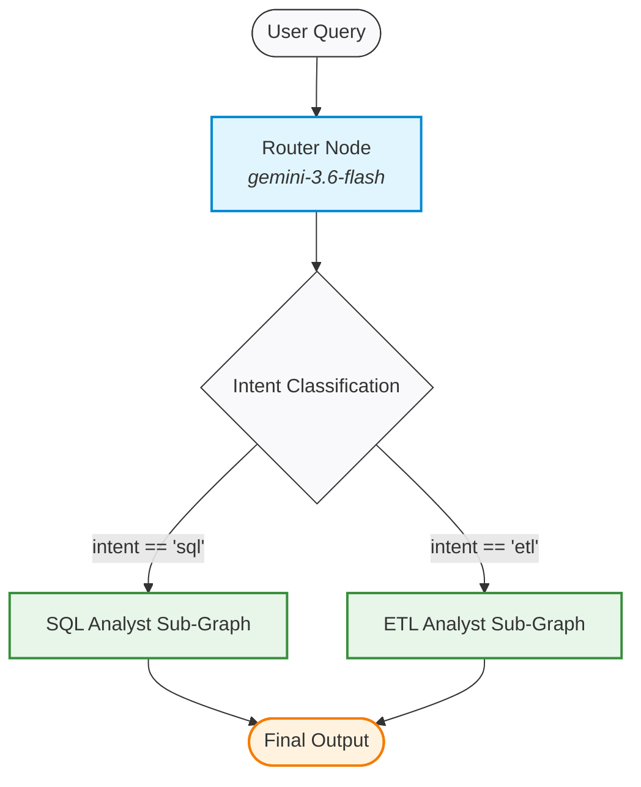
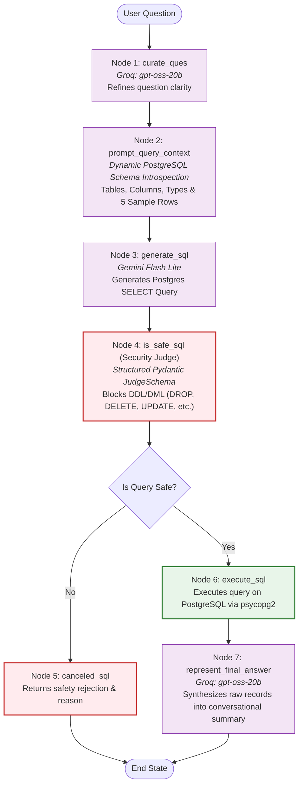
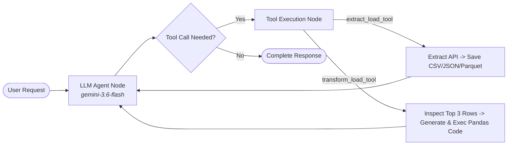
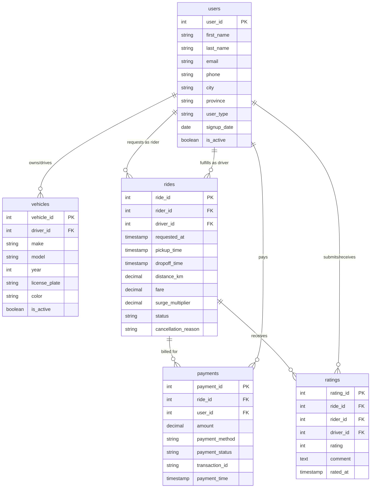

# 🤖 DataAgent: Autonomous Multi-Agent Data Intelligence & ETL System

[](https://www.python.org/)
[](https://langchain-ai.github.io/langgraph/)
[](https://www.postgresql.org/)
[](https://github.com/astral-sh/uv)
[](LICENSE)

**DataAgent** is an enterprise-grade, multi-agent AI system built on **LangGraph**, designed to unify natural language SQL analytics and autonomous ETL workflows. It intelligently routes user inquiries between a **Guardrailed SQL Analyst Agent** (for introspective querying on PostgreSQL) and a **ReAct ETL Analyst Agent** (for dynamic API extraction, tabular serialization, and AI-driven Pandas transformations).

---

## 📑 Table of Contents

- [System Architecture](#-system-architecture)
  - [High-Level Routing Graph](#high-level-routing-graph)
  - [SQL Analyst Guardrailed Pipeline](#sql-analyst-guardrailed-pipeline)
  - [ETL Analyst ReAct Loop](#etl-analyst-react-loop)
- [Key Features](#-key-features)
- [Multi-Tier LLM Architecture](#-multi-tier-llm-architecture)
- [Database Schema & Domain](#-database-schema--domain)
- [Project Directory Structure](#-project-directory-structure)
- [Prerequisites & Installation](#-prerequisites--installation)
- [Environment Configuration](#-environment-configuration)
- [Database Setup & Data Ingestion](#-database-setup--data-ingestion)
- [Usage & Execution](#-usage--execution)
  - [Running the Main Agent](#running-the-main-agent)
  - [Example: Natural Language SQL Analytics](#example-natural-language-sql-analytics)
  - [Example: Autonomous ETL Operations](#example-autonomous-etl-operations)
- [Security & Guardrails](#-security--guardrails)
- [Roadmap](#-roadmap)

---

## 🏛 System Architecture

DataAgent employs a hierarchical multi-agent pattern orchestrated via **LangGraph StateGraphs**.

### High-Level Routing Graph

The **Master Router** analyzes incoming user intent using structured Pydantic schemas and conditionally routes execution to the appropriate specialized sub-agent.



---

### SQL Analyst Guardrailed Pipeline

The **SQL Analyst Agent** operates through a 7-stage deterministic workflow ensuring high query accuracy and zero destructive actions on the database:



---

### ETL Analyst ReAct Loop

The **ETL Analyst Agent** functions as a tool-augmented ReAct agent capable of autonomous data extraction and programmatic Pandas data transformations:



---

## 🚀 Key Features

- **Intelligent Query Intent Routing**: Zero manual switching. Automatically differentiates between operational analytics requests and data extraction/transformation requests.
- **Dynamic Schema Introspection**: Eliminates static hallucinations. Before generating SQL, live schemas (table names, columns, data types) and actual sample rows are fetched dynamically from PostgreSQL.
- **Enterprise Security Judge Node**: Every generated SQL query is passed through a dedicated security evaluator LLM that enforces a strict read-only policy. Destructive commands (`DROP`, `TRUNCATE`, `DELETE`, `ALTER`, `UPDATE`, `INSERT`, `CREATE`) are intercepted and rejected with explanations.
- **Autonomous Multi-Format ETL**: Extracts structured data from REST endpoints and saves directly to disk in `CSV`, `JSON`, or `Parquet` formats.
- **Context-Aware Dynamic Code Generation**: The ETL agent inspects the top 3 rows of any dataset to understand its structure, writes custom Pandas transformation code, and executes it in a sandboxed environment.
- **Multi-Tier Model Selection**: Integrates Groq, Google Gemini, and OpenRouter for optimal balancing of cost, speed, and reasoning depth.

---

## ⚡ Multi-Tier LLM Architecture

DataAgent employs a flexible provider abstraction (`utils/llm_pick.py`) allowing different agent nodes to consume models suited to their workload:

| Tier | Provider | Default Model | Used For |
| :--- | :--- | :--- | :--- |
| **`low`** | **Groq** | `openai/gpt-oss-20b` | High-speed question curation, final conversational answer synthesis |
| **`medium`**| **Google Gemini** | `gemini-3.1-flash-lite` | Accurate Text-to-SQL generation, SQL safety evaluation |
| **`gemini`**| **Google Gemini** | `gemini-3.6-flash` | Master Router classification, ETL Tool selection, Pandas code generation |
| **`high`** | **OpenRouter** | `openrouter/free` | Extensible fallback for complex multi-step reasoning |

---

## 🗄 Database Schema & Domain

The embedded relational data model mimics a real-world **Ride-Sharing / Mobility Platform** loaded into PostgreSQL:



---

## 📁 Project Directory Structure

```plaintext
dataagent/
├── .env.example               # Template environment configuration file
├── .gitignore                 # Optimized ignore rules for Python, ETL & environments
├── pyproject.toml             # Project dependencies and build configuration (UV)
├── uv.lock                    # Dependency lockfile
├── main.py                    # Application entrypoint
├── feed_db.py                 # DDL migration & automated CSV database seeder
├── data_agent_graph.png       # Mermaid-rendered master agent graph
│
├── agents/                    # LangGraph Agent Workflows
│   ├── data_agent.py          # Master Router Agent Graph
│   ├── sql_analyst.py         # 7-Step Guardrailed Text-to-SQL Graph
│   └── etl_analyst.py         # ReAct ETL Agent (API extraction & Pandas transformation)
│
├── Models/                    # Pydantic Schemas & State Specifications
│   └── schema.py              # AgentSchema, JudgeSchema, RouterSchema, ETLAgentSchema
│
├── utils/                     # Core Utilities & Services
│   ├── database.py            # PostgreSQL connection pool & dynamic schema introspection
│   ├── etl_tools.py           # REST ingestion, file serialization & code runner
│   ├── llm_pick.py            # Tiered multi-provider LLM selector (Groq, Gemini, OpenRouter)
│   └── test_schema_details.txt# Reference dump of introspected schema & sample data
│
└── data/                      # Data assets & runtime working directories
    ├── users.csv              # Seed data: User profiles (riders & drivers)
    ├── vehicles.csv           # Seed data: Vehicle specifications
    ├── rides.csv              # Seed data: Historical ride bookings & GPS metrics
    ├── payments.csv           # Seed data: Payment transactions & methods
    ├── ratings.csv            # Seed data: Ride reviews & feedback
    ├── extract/               # Target directory for API extractions (.gitkeep tracked)
    └── transform/             # Target directory for transformed outputs (.gitkeep tracked)
```

---

## 🛠 Prerequisites & Installation

### Prerequisites

- **Python**: Version `3.13` or higher
- **PostgreSQL**: Version `14` or higher (running locally or accessible via network)
- **uv** (Recommended modern Python package manager):
  ```bash
  # Windows (PowerShell)
  powershell -ExecutionPolicy ByPass -c "irm https://astral.sh/uv/install.ps1 | iex"

  # macOS / Linux
  curl -LsSf https://astral.sh/uv/install.sh | sh
  ```

### Installation

1. **Clone the repository:**
   ```bash
   git clone <repository_url>
   cd dataagent
   ```

2. **Create and sync the virtual environment using `uv`:**
   ```bash
   uv venv
   # Activate virtual environment
   # Windows:
   .venv\Scripts\activate
   # Linux/macOS:
   source .venv/bin/activate

   # Install all dependencies with uv lockfile precision:
   uv pip install -e .
   ```

   *(Alternatively, using standard pip: `pip install -e .`)*

---

## ⚙ Environment Configuration

1. Copy the example configuration to a live `.env` file:
   ```bash
   cp .env.example .env
   ```

2. Fill in your API keys and database credentials inside `.env`:

   ```ini
   # LLM Providers
   GOOGLE_API_KEY=AIzaSy...
   GROQ_API_KEY=gsk_...
   OPENROUTER_API_KEY=sk-or-v1-...

   # PostgreSQL Connection Parameters
   host=localhost
   port=5432
   database=your_postgres_database_name
   user=your_postgres_user_name
   password=your_secure_password
   ```

---

## 📥 Database Setup & Data Ingestion

The repository includes a self-contained database migration and seeder script ([`feed_db.py`]) that:
1. Creates the `public` schema and all relational tables (`users`, `vehicles`, `rides`, `payments`, `ratings`).
2. Configures foreign keys, check constraints, and performance indexes.
3. Automatically truncates existing tables to prevent duplicate records.
4. Performs high-speed bulk ingestion of CSV files via the PostgreSQL `COPY ... FROM STDIN` protocol.

Execute the seeder:
```bash
python feed_db.py
```

Expected output:
```plaintext
Connected to PostgreSQL
Tables created successfully
Loaded users.csv
Loaded vehicles.csv
Loaded rides.csv
Loaded payments.csv
Loaded ratings.csv

Record counts:
----------------------------------------
users                10,000
vehicles              1,000
rides                20,000
payments             20,000
ratings              10,000

Data loaded successfully!
PostgreSQL connection closed.
```

---

## 🖥 Usage & Execution

### Running the Main Agent


```bash
python main.py
```

### Example: Natural Language SQL Analytics

```python
from agents.data_agent import data_agent
from langchain_core.messages import HumanMessage

# Ask any analytical or business question
query = "What are the different types of Payment Methods we have in our database?"

response = data_agent.invoke({
    "messages": [HumanMessage(content=query)],
    "route_response": ""
})

print(response["messages"][-1].content)
```

**Workflow Execution:**
1. **Router**: Classifies query as `"sql"`.
2. **SQL Curator**: Clarifies the question intent.
3. **Context Builder**: Pulls `payments` column definitions and sample methods (`credit_card`, `debit_card`, `paypal`, `apple_pay`).
4. **Generator**: Constructs `SELECT DISTINCT payment_method FROM public.payments LIMIT 10;`.
5. **Security Judge**: Validates that query is read-only (`is_safe = "Yes"`).
6. **Executor**: Runs query against PostgreSQL.
7. **Synthesizer**: Delivers concise, user-friendly bullet points of available payment methods.

---

### Example: Autonomous ETL Operations

```python
from agents.data_agent import data_agent
from langchain_core.messages import HumanMessage

# Trigger an API data extraction pipeline
extract_query = (
    "I want to extract data from the API endpoint 'https://pokeapi.co/api/v2/pokemon' "
    "and save it to data/extract folder in the csv format."
)

response = data_agent.invoke({
    "messages": [HumanMessage(content=extract_query)],
    "route_response": ""
})

print(response["messages"][-1].content)
```

**Workflow Execution:**
1. **Router**: Identifies extraction intent and routes to `"etl"`.
2. **ETL Agent**: Dispatches `extract_load_tool(url=..., output_folder='data/extract', format='csv')`.
3. **Tool Execution**: Fetches payload, flattens JSON via `pandas.json_normalize`, and exports to `data/extract/extracted_data.csv`.

---

## 🛡 Security & Guardrails

Enterprise analytical systems must guarantee safety against unauthorized mutations:

1. **SQL Security Judge**:
   - Every candidate SQL query is evaluated by an LLM with structured output (`JudgeSchema`).
   - Hard bans on any statement altering state: `INSERT`, `UPDATE`, `DELETE`, `DROP`, `ALTER`, `TRUNCATE`, `CREATE`, `REPLACE`, `GRANT`, `REVOKE`.
   - If an unsafe command is detected, execution immediately routes to `canceled_sql` and halts.
2. **Default Limits**:
   - All generated SQL queries automatically append `LIMIT 10` unless explicitly overridden by the user, guarding against accidental table scans or out-of-memory states.
3. **API Key Isolation**:
   - Sensitive credentials remain strictly inside `.env` (guarded by comprehensive `.gitignore` rules) and are never logged or committed.

---

## 🗺 Roadmap

- [ ] Add conversation memory across multi-turn user sessions (`MemorySaver` / SQLite Checkpointer).
- [ ] Add vector search semantic layer for automated column mapping on massive database schemas.
- [ ] Integrate automated chart and visualization generation (Matplotlib / Plotly) in the final response.
- [ ] Add Docker Compose support for instant one-click deployment of PostgreSQL and DataAgent.

---

## 👤 Author

**Satyam Chaturvedi**  
- Email: [ssatyamsharma5678@gmail.com](mailto:ssatyamsharma5678@gmail.com)
